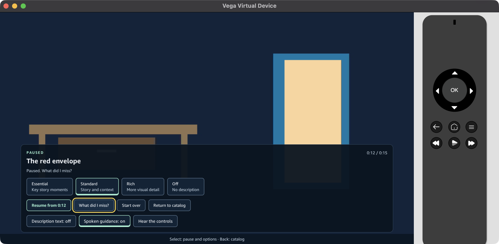
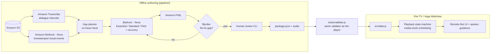

# Sema: never lose the story (Fire TV / Vega OS)

**On Fire TV, a missed audio description is not a lost story.** If a description is interrupted (you paused, the film buffered, a line couldn't fit), Sema keeps that story fact. One remote button, **"What did I miss?"**, brings it back without spoilers.

[](https://github.com/Jeremiah-Sakuda/sema-firetv/actions/workflows/ci.yml) [](LICENSE) · Fire TV track · AWS Builder mini-challenge · Build, Ship, Shape: Amazon Developer Hackathon 2026



*Sema on the Vega Virtual Device (Vega SDK 0.24). Focus is outlined in yellow, and every spoken announcement ends with the control that has focus.*

---

## Why

Audio description (AD) narrates what happens on screen in the gaps between dialogue. When a line is missed (a pause, a buffer, a gap too short to speak in), that moment is usually just gone; the viewer rewinds and hopes. Sema is a Fire TV app built around one promise: **you can always get the story back from the remote.**

- **Recovery that is reliable.** Every critical story fact is tracked as *not yet due*, *heard*, *waiting* or *skipped by you*. An interrupted fact waits until you hear it, even across scene changes, and the film pauses only when a critical fact is lost. Optional detail that can't fit is dropped quietly.
- **Remote-first.** Every screen keeps a focused control, and every announcement ends with the control Select will activate. Nothing depends on the Menu key, which never reaches the WebView.
- **Three detail levels (supporting).** Essential, Standard or Rich, where the dialogue gap allows.
- **Reviewed content.** An AWS pipeline (S3, Transcribe, Bedrock Nova, Polly) drafts every level and recovery line, measures each rendered line against its gap, and **production publication requires a person's approval**.

**Related work.** Customizable AD has been explored before. [CustomAD](https://www.guoanhong.com/papers/ASSETS24-CustomAD.pdf) (ASSETS 2024) studied customizing audio description, and [ViDscribe](https://arxiv.org/abs/2603.14662) (2026) combines customized descriptions with conversational video questions. Sema does not claim customization as new. Its contribution is narrower: dependable, spoiler-safe recovery of interrupted AD on a television, operated entirely from the remote, with pre-rendered audio, a production human-approval gate and no generation at viewing time.

**Who it's for first.** Independent and festival short films, which need AD for accessibility requirements and can grant rights. Sema would be the player plus a reviewed authoring service. It is not an integration with existing streaming services.


## Try it in two minutes (web build, no AWS account needed)

The player is a web app. The exact same files run inside the Fire TV (Vega) WebView.

```bash
npm ci               # locked dev dependencies (jsdom, for tests)
npm test             # player, release validation and remote/focus tests
npm start            # bundles, then serves http://127.0.0.1:4173
```

Use the keyboard as the remote:

| Key | Remote button |
|---|---|
| Arrow keys | D-pad |
| Enter | Select |
| Esc | Back |
| Space | Play/Pause |

Add `?debug` to the URL for the fault-injection and event-log panel. Add `?study=fixed` for the fixed-Standard comparison mode used in viewer sessions.

## Run it on Fire TV (Vega OS)

The full, tested steps are in **[docs/vega/BUILD-AND-RUN.md](docs/vega/BUILD-AND-RUN.md)**. In short:

```bash
npm run webm && npm run bundle && npm run vega:sync   # VP8 renditions, then copy the web app into vega-app/assets/
cd vega-app && npm install && npm run build:staged    # writes build/vpkg/sema_aarch64.vpkg (works with spaces in the path)
vega virtual-device start
vega run-app build/vpkg/sema_aarch64.vpkg com.sema.viewer.main
```

**[docs/vega/PLATFORM-FINDINGS.md](docs/vega/PLATFORM-FINDINGS.md)** records what we *measured* on the Vega Virtual Device:
- real remote key codes
- that `fetch()` cannot read `file://` assets
- how `speechSynthesis` behaves
- VoiceView focus tracking
- the VVD's H.264 playback limits

The app is built around those facts:
- Package data ships as a script, so there is no `fetch`.
- Spoken guidance supports pre-rendered Polly clips, with a watchdog on every utterance. All 61 clips were generated with Polly and bundled; actual audible verification remains pending.
- Films ship as VP8 WebM on Vega, because H.264 stalls on the VVD.
- Nothing depends on the Menu key, which never reaches the WebView.

## How the remote works

The player keeps a focused control while paused. Every state change says what happened, then names the control that actually has focus ("Paused. What did I miss?"). Prompts never hard-code focus or directions, so speech cannot contradict the layout; a test walks a whole viewing and checks this after every announcement.

| You are… | You press | Sema does |
|---|---|---|
| Watching | **Select** (or any D-pad key) | Pauses, opens the controls, focuses **What did I miss?** |
| Watching | **Back** | Pauses, focuses **Return to catalog**; Back again leaves |
| Watching | **Play/Pause** | Pauses, focuses **Resume** |
| On **What did I miss?** | **Select** | Describes the most recent moment, or a pending interrupted one first; then focuses **Resume** |
| Paused | **Select** on a level | Switches level; the change applies from the next description |
| Paused | **Select** on Start over | Asks for a second Select first; moving away cancels |
| Describing a missed moment | Any arrow | Stops the description (the fact stays waiting) and names the new control |
| Anywhere | **Rewind / Fast-forward** | Seeks 5 s. Narration rebuilds at the new position; skipped facts are recorded as *skipped*, not as *heard* |
| On the catalog | **Back** | Leaves the app |

**Spoken guidance** uses the generated Polly clip set to read focused controls and state changes using the same voice as the narration. Any key press interrupts it. **VoiceView users** turn it off and use VoiceView for controls and status; audible hardware behavior is pending verification; state changes then go to an ARIA live region.

Guidance speaks while the film is paused. Explicit Help and preference confirmations stop recovery first, announce the stopped state and Resume focus, and preserve an interrupted critical fact for recovery. Mocked-media regressions verify this sequencing; actual audible output still needs testing.

**Adaptive suggestion:** if you ask "What did I miss?" about recent moments twice within 30 seconds of film, Sema offers Rich, while you're already paused. It makes the offer at most once per viewing.

**Film sound** is lowered under narration and restored afterwards, as in broadcast AD.

## Architecture



**The player** (`src/`, plain JavaScript, no runtime dependencies):

- **`playback.js`** is a pure media-clock state machine.
  - It schedules narration from the video position, never wall-clock timers.
  - It checks the fit twice: when a cue is due, and when its audio actually starts.
  - If a cue is reached late, it falls back to a shorter *reviewed* variant instead of rushing.
  - It cancels stale audio callbacks via generation tokens.
  - It tracks each critical event as *not due → delivered / pending / bypassed*.
  - It keeps a versioned resume record.
- **`package.js`** rejects any package with future facts, dialogue overlap, unmeasured or ill-fitting audio, unsafe paths, or missing human approval.
- **`app.js`** contains the remote contract, focus guarantees, onboarding, resume and start-over, the adaptive suggestion, and error and retry states.
- **`voice.js`** handles spoken guidance: Polly clips first, speech synthesis as fallback, and a watchdog so nothing ever waits on a completion event.

**The authoring pipeline** (`pipeline/`, Python + boto3) is documented in **[pipeline/README.md](pipeline/README.md)**. That covers each AWS service's role, the IAM policy, live commands, the deterministic fit loop, and the optional **Strands Agents** fit-loop agent. Its offline tests refuse to build live AWS clients (`SEMA_FORBID_LIVE=1`, also set in CI).

## AWS integrations used in the live pilot

| Service | What it does in Sema |
|---|---|
| **Amazon S3** | Stores the authorized source film. Input for Transcribe and Nova; output location for Transcribe |
| **Amazon Transcribe** | Word-level timestamps, which become the dialogue intervals narration must never overlap |
| **Amazon Bedrock: Amazon Nova** | Examines timestamped frame batches in the successful pilot; video input was also tried and rejected. Drafts observations and narration; the pilot required explicit AI editorial corrections before the pending human review. Rewrites lines that do not fit their gap |
| **Amazon Polly** (neural) | Voices every description level, recovery cue and UI prompt in one consistent voice |
| **Strands Agents SDK** (optional `--agent`) | Runs the fit loop as an agent with three tools: `render_with_polly`, `measure_duration` and `check_window`. The result comes from our own measurements, never from the agent's claim |


## Evidence

- **Tests**
  - `npm test`: player and release tests, including jsdom remote-flow tests that assert where focus lands after every transition.
  - `pipeline/`: offline tests.
- **Platform**: [docs/vega/PLATFORM-FINDINGS.md](docs/vega/PLATFORM-FINDINGS.md), with screenshots and device logs.
- **Friction log**: [docs/FRICTION-LOG.md](docs/FRICTION-LOG.md). 21 real, reproducible issues with the Vega SDK, VVD and WebView, each with verbatim errors, a workaround and a suggestion.

## Films and credits

The planned two-film catalog uses excerpts of the Blender Foundation's open movies under **CC BY 3.0**. See [media/ATTRIBUTION.md](media/ATTRIBUTION.md) and `content/rights/`.

- *Sintel* (2010): © copyright Blender Foundation | durian.blender.org
- *Tears of Steel* (2012): (CC) Blender Foundation | mango.blender.org

The source excerpts were re-encoded. Their Sema narration drafts have completed live AWS authoring and still require human review before packaging. The Blender Foundation does not endorse this project. `npm run content:fetch` reproduces both excerpts from the official mirror.

## Limitations (honest)

- **On the Vega Virtual Device, H.264 and VP9 stall about 3 s in** (platform decoder path). Sema ships VP8/Opus WebM renditions, which play through, and selects them on Vega OS. We have not yet verified H.264 on physical Fire TV hardware.
- **VoiceView can be enabled on the VVD and tracks focus, but the VVD has no TTS engine.** VoiceView speech could only be verified on hardware.
- **AI drafts can miss brief actions or mis-describe them.** Publication requires human approval. No real-film approval is recorded yet. AI edits and human review decisions are tracked separately; timing checks and critical-event references cannot prove factual completeness.
- **This is a two-film pilot in preparation.** It doesn't integrate with Prime Video or any other streaming service.

## Release and study gates

```sh
PYTHONPATH=pipeline pipeline/.venv/bin/python -m sema_pipeline preflight --profile sema --bucket YOUR_BUCKET
pipeline/.venv/bin/python tools/run-live-pilot.py --profile sema --bucket YOUR_BUCKET  # preview only
# After AWS sign-in: same command with --live (and --create-bucket if needed).
# It generates guidance and both drafts, then stops before human review.
npm run release:check  # fails until both reviewed films, media and guidance are present
```


## Repository map

```
index.html, style.css, src/      the player (bundled by tools/bundle.js into src/bundle.js + src/data.js)
media/                           packaged films, audio, prompts; media/catalog.json lists the catalog
pipeline/                        AWS authoring pipeline (Python), offline tests, IAM policy
vega-app/                        Vega OS (Fire TV) WebView app that hosts the player
tests/                           player unit + remote-flow tests
tools/                           bundle, serve, validate, posters, vega-sync, content fetch, Vega platform probe
docs/                            findings, friction log, Vega build/run + platform findings, submission drafts, planning history
```

## License

The code is under [MIT](LICENSE). The films are under CC BY 3.0 (see above).
