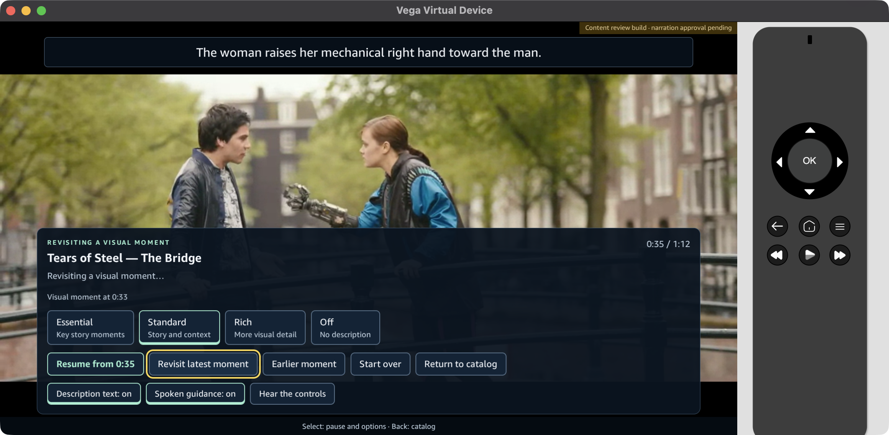

# Sema

### Audio description at your pace.

**Sema gives blind and low-vision viewers control over the visual story on Fire TV: choose the amount of description, revisit a visual moment from the remote, then continue from the same frame.**

Built for **Fire TV / Vega OS**, with an AWS authoring pipeline. Code: [MIT](LICENSE). Film excerpts: [CC BY 3.0](media/ATTRIBUTION.md).

## One scene

In the bridge scene of *Tears of Steel*, the recorded dialogue intervals span almost all of 23.05–45.22 s. The two gaps last 1.21 s and 0.75 s. The included fixed Standard soundtrack leaves two visual details undescribed: a man and woman standing beside a canal, and the woman raising a mechanical right hand toward the man. Sema makes both descriptions available while the film is paused.



*Vega Virtual Device capture from October 8; the current controls have since been refined.*

1. **Select** pauses the film and focuses **Revisit latest moment**.
2. **Select** again: *"The woman raises her mechanical right hand toward the man."*
3. After the description finishes, focus returns to Resume. Press **Right twice**, then **Select** on **Earlier moment**: *"A man and a woman stand beside a canal on a metal bridge."*
4. **Play** continues from the paused frame.

Four of the excerpt's 13 described moments are available through Revisit without a timed cue in this package. This example shows additional visual information becoming available at the viewer's request. The included Standard mix uses Sema's own narration assets; it is not the film's official audio-description track.

## Who it is for

The viewer is a blind or low-vision person who wants to choose how much visual description to hear and when to pause for it. In [Describe Now](https://arxiv.org/abs/2411.11835), a study with 20 blind and low-vision participants found differing preferences for description frequency and detail across videos. That external research informs Sema's choice of controls.

The intended first adopter is an **independent film publisher with a small licensed catalog and control of its Fire TV app**. That publisher can supply authorized films, assign an editor and integrate the player. A practical first deployment would be one short-film collection: prepare and review each title's description once, then offer detail selection and Revisit to viewers through the remote.

For the publisher, the proposed value is an accessible viewing experience it can offer within its own app while retaining control of the scripts and release. Sema provides an MIT-licensed reference player and an authoring pipeline that a publisher can adapt. The proposed adoption path uses the publisher's own catalog and app; the current prototype contains two excerpts. It does not connect to Prime Video or other streaming services.

## What Sema does

| Viewer action | Behavior |
|---|---|
| Choose the amount of description | Essential, Standard or Rich. Available dialogue gaps constrain length: Rich shares Standard wording in 9 of 19 windows. |
| Revisit a moment | The film stays paused while Sema describes an available visual moment. Earlier moment steps further back. Only events timestamped at or before the current position are offered. |
| Recover interrupted narration | An interrupted critical description is offered first and stays available until heard or deliberately skipped. |
| Keep watching | Timed descriptions fit within the package's recorded dialogue gaps. Fit is checked again when narration starts; stalls and late starts have recovery paths. |
| Use spoken guidance or VoiceView | Recorded prompts announce controls and state changes. VoiceView detection disables Sema's guidance by default; a viewer's explicit preference takes precedence. |
| Resume and keep preferences | Detail level and film position persist. More options contains text, spoken guidance, help and confirmed Start over. Back closes these options first. |

The catalog contains two **72-second** Blender open-film excerpts: *Sintel — The Rooftop* and *Tears of Steel — The Bridge*. They include 25 described moments, 57 timed narration variants, 67 recorded control prompts and 25 concise recorded moment names. All playback media is in the repository. Film narration and 63 control prompts use Amazon Polly; moment names and four viewing-options prompts use local Piper speech. Watching uses local files and makes no model or cloud-service call.

## Publisher workflow

1. **Supply an authorized film.** Amazon S3 holds the authoring input; Amazon Transcribe supplies dialogue timestamps.
2. **Prepare descriptions.** Bedrock Nova Pro observes timestamped frames. Nova 2 Lite drafts three detail levels and a separate Revisit description for each moment.
3. **Render and check.** Amazon Polly voices the lines. The pipeline measures each timed recording, retries lines that do not fit and checks required facts.
4. **Edit and approve.** The production workflow requires editorial decisions bound to the exact source, timing and audio.
5. **Package for the publisher's app.** The player uses prepared media locally, so the viewer can request a description without waiting for generation.

The [pipeline guide](pipeline/README.md) documents the working CLI and release checks. Publisher integration is an adaptation of this reference implementation; a self-service publishing product and a full-length catalog have not been built.

Measured in the [October 4 live run](docs/evidence/aws/LIVE-PILOT-2026-10-04.json):

| Authoring measurement, per 72-second excerpt | Sintel | Tears of Steel |
|---|---:|---:|
| Estimated AWS list-price usage, including recorded reruns | $0.38 | $0.32 |
| Latest automated stage total | 97 s | 86 s |
| Sum of recorded attempt durations | 232 s | 180 s |
| Timed variants fitting on first render | 32 of 33 | 22 of 24 |

These are pilot service estimates and recorded stage durations, not total production cost or end-to-end elapsed time. An AI editorial pass outside the pipeline changed 78 of 83 drafted lines; [`content/editorial/`](content/editorial/) retains the before-and-after record. Human editorial effort has not been measured. That work, publisher integration and distribution must be accounted for before estimating a commercial catalog's cost.

## What makes the interaction distinctive

Sema combines detail choice, timestamp-bounded Revisit and interruption recovery in a remote-only Fire TV experience. The publisher prepares descriptions ahead of time; the viewer controls when to hear more.

[Extended audio description](https://www.w3.org/WAI/WCAG22/Understanding/extended-audio-description-prerecorded.html) provides extra description by pausing video. Related work explores viewer-controlled timing and detail ([Describe Now](https://arxiv.org/abs/2411.11835)), customizable description ([CustomAD, ASSETS 2024](https://www.guoanhong.com/papers/ASSETS24-CustomAD.pdf)) and conversational video description ([ViDscribe, 2026](https://arxiv.org/abs/2603.14662)). Sema's contribution is the implemented television workflow: D-pad control, past-moment browsing, preserved interrupted facts and locally prepared playback.

## Prototype scope

- **Content:** two excerpts with AI-prepared narration. Production packaging requires separate editorial approval; the included prototype does not carry that approval.
- **Platform:** the October 8 build ran in the Vega Virtual Device. The October 15 source passed browser checks and an aarch64 SDK build; that package has not been run in the simulator. Physical Fire TV and audible VoiceView remain unverified.
- **Behavior:** timestamp checks exclude later events from Revisit selection. Description accuracy depends on the authored content; event selection alone is not a semantic spoiler guarantee.

## Try it

Requires **Node.js 22** and npm. No AWS account is needed to run the included two-film prototype.

```sh
npm ci
npm run preview
```

Open **http://127.0.0.1:4173**. Use arrow keys as the D-pad, Enter as Select, Escape as Back and Space as Play/Pause. For the target platform, follow the [Vega build guide](docs/vega/BUILD-AND-RUN.md).

For the bridge example, start *Tears of Steel* from the beginning and pause at about **38 seconds**, before the next event at 44 seconds. Then follow the four steps under "One scene".

To hear detail choice, compare the *Sintel* alley cue at about 6 seconds in separate runs: Essential says *"A woman walks."* Rich says *"A red-haired woman carries a staff through a narrow sunlit alley."*

## Verified behavior

The October 14 checks passed 129 JavaScript tests, 75 offline pipeline tests, eight complete real-media browser runs and both films' interruption/revisit/resume paths. Final checks decoded all 25 moment names and four viewing-options prompts. Browser output was muted; these checks establish media events and interaction behavior, not heard-audio quality. The aarch64 Vega package built with 200 matched assets.

October 15 checks passed 133 JavaScript tests, both description contracts, repository checks and the focused real-media keyboard flow through Revisit, two Right presses to Earlier moment, resume and each Back action. The updated aarch64 package built with 200 matched playback assets and was not launched.

Earlier Vega runtime observations and five native host tests retain their October 8 date. [Test commands, evidence and scope](docs/TESTING.md) distinguish those observations from current browser and build checks.

```sh
npm test
npm run preview:build
npm run repo:check
npm run content:check
```

## Repository guide

| Path | Contents |
|---|---|
| `src/`, `index.html`, `style.css` | Player state, narration, remote input and interface |
| `preview/media/` | Portable two-film media snapshot, Standard mixes and integrity manifest |
| `media/` | Spoken guidance, engineering fixture and production catalog |
| `vega-app/` | Native Vega WebView host and package build |
| `pipeline/` | AWS authoring stages and offline tests |
| `content/editorial/` | Record of the AI editorial pass on the draft narration |
| `tests/`, `tools/` | Regression tests, bundling, media checks and platform diagnostics |
| `docs/` | Setup, architecture, evidence, friction log and developer feedback |

[Documentation index](docs/README.md) · [Architecture](docs/ARCHITECTURE.md) · [Viewing language](GLOSSARY.md) · [Friction log](docs/FRICTION-LOG.md) · [Product feedback](docs/PRODUCT-FEEDBACK.md) · [Contributing](CONTRIBUTING.md)

Film credits and adaptation details are in [media attribution](media/ATTRIBUTION.md).

## Prepare the source handoff

Run `npm run submission:prepare` after `npm ci`. It exports the current public source, verifies an independent copy with an offline dependency install, tests and prototype build, and produces a source archive plus per-file hashes. Private drafts and generated files are excluded. Outputs remain under `.local/submission/kit/`; the command does not publish anything.
