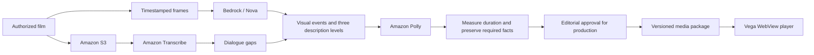

# Architecture

AWS prepares descriptions before release. The TV plays the resulting files locally while the viewer controls detail and Revisit from the remote.

The repository contains a CLI for authoring and a Vega WebView player. Publishers can also use `src/playback.js` in another player; it has no browser dependencies.

## Viewing

| Module | Responsibility |
|---|---|
| `src/playback.js` | Choose narration and track delivery using the film's playback position |
| `src/playback-session.js` | Start and stop media, preload audio, handle stalls and fade volume |
| `src/app.js` | Handle remote input, focus, status text and saved preferences |
| `src/voice.js` | Play recorded guidance in order and handle timeouts |
| `vega-app/` | Load the bundled player and connect it to native controls |

Each attempt to start video is tracked separately. Pausing, seeking, restarting, changing films or leaving cancels outstanding attempts and their timers. A failure from an old attempt cannot interrupt a newer one. Resetting the session also releases preloaded audio and volume timers.

The scheduler checks whether a line fits both when requested and when audio starts. A cue reached late is requested at the longest level that still fits; if its audio then starts too late to finish inside the window, the line is dropped. An interrupted critical description remains recoverable; optional detail can be skipped without stopping the film. Only completed narration marks a fact as delivered.

Revisit selects an event whose `availableAt` is no later than the current film position. Earlier moment steps backward through those events. Action buttons keep compact visible labels in fixed grid columns. Each moment has a short name, including those without timed narration. Screen-reader labels include the name and timestamp; recorded guidance uses the same names. The context line shows the description being played or just completed, followed by the next Earlier target. It marks a description complete only when its audio finishes. Seeking clears that context. After browsing, focus stays on Earlier moment while another past event is available; at the oldest event it returns to Resume. The film remains paused during narration, and Resume is explicit. Timestamp checks constrain event selection; factual and semantic correctness also depend on editorial work.

The pause panel puts Resume, Revisit and Earlier moment first, followed by description detail. More options contains text, spoken guidance, help and Start over. It restores focus when closed; Back closes it before leaving the film. Opening options during a description cancels that audio and preserves any interrupted critical fact. A delayed native startup response never replaces the current interaction or moves its focus.

If recorded guidance and speech fallback both fail, the film pauses and a focused Retry / Return to catalog screen appears. With VoiceView detected, Continue with VoiceView disables app guidance and restores the current controls, paused frame and pending facts. This action is hidden when no screen reader is detected. Returning to the catalog also disables app guidance.

During established playback, a video `waiting` event cancels active independent narration immediately and pauses the player. Interrupted critical facts remain available for Revisit, and stale completion callbacks cannot mark them delivered. Between descriptions, waits shorter than 900 ms are tolerated before showing buffering controls.

The native host waits up to 15 seconds for a player-ready message. Main-page loading errors and missing readiness display native Retry / Exit controls. Retry remounts the WebView and ignores callbacks from the previous attempt.

Guidance runs while the film is paused. Any action can interrupt it. Explicit help or preference announcements stop revisit narration first, preventing overlapping speech. Focus is restored after transitions and announced through recorded guidance or the screen-reader status region.

## Media and packages

Packages contain film metadata, dialogue intervals, visual events, timed cues and measured audio variants. Validation checks timing, required coverage and safe asset paths. The prototype build also checks explicit identifying-fact requirements in `content/description-contracts.json`; these check that identifying details survive shortened descriptions. Versioned resume state prevents a changed package from silently inheriting incompatible delivery state.

`preview/media/` is a portable prototype snapshot. `npm run preview:build` verifies its hashes and rebuilds the shell without cloud credentials. Production uses separate approval fingerprints binding scripts, timing, source and audio bytes. Editing those bytes invalidates approval, and only the review step can grant it.

`tools/playback-assets.js` lists the required playback files and checks recorded clips. Bundling and production checks apply the same text, path, duration and byte-fingerprint policy to Polly guidance, Piper options and moment names. The prototype and site builders use the inventory so independent moment-name audio cannot be omitted. The Polly prompt renderer writes fingerprints for future recordings; current audio was fingerprinted without re-rendering.

Vega uses VP8 video and Opus audio. Its data arrives in a generated script because local WebView fetch/XHR was unreliable. Build output is disposable and generated from source.

## AWS integration

| Service | Actual role |
|---|---|
| S3 | Upload source films and exchange authoring inputs and transcription results |
| Transcribe | Batch word timestamps used to plan dialogue-free windows |
| Bedrock / Nova Pro | Observe timestamped frame batches in the live pilot |
| Bedrock / Nova 2 Lite | Draft narration levels, visual-moment descriptions and shorter variants |
| Polly neural | Render measured MP3 narration and control prompts |

Live authoring calls record usage and stage timing. AI editorial passes (Codex and Claude Code) then corrected the drafts against the source frames. [`content/editorial/`](../content/editorial/) records the frame checks, text revisions and shipped wording; `npm run content:check` fails if the record and the package disagree. The live run used the deterministic fit loop; a Strands Agents version is included with offline tests.

## Comparison modes

- Normal URL: detail selection and revisit.
- `?study=fixed`: a single premixed Standard soundtrack, with conventional pause/rewind and no independent cue scheduling or revisit.
- `?study=recovery`: Standard detail locked, with revisit available.

Both comparison soundtracks use the same Standard narration assets. Dynamic volume fades and premix boundaries can differ slightly.
