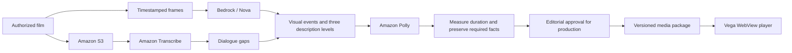

# Architecture

Sema separates authoring from viewing. AWS produces timed narration assets; the television plays local files and responds immediately to remote input.

## Viewing

`src/playback.js` is a pure state machine driven by the film's media clock. `src/app.js` connects it to video, narration, remote keys and focus. `src/voice.js` sequences recorded guidance with timeout handling. The native host in `vega-app/` loads the same bundled player from local assets.

The scheduler checks whether a line fits both when requested and when audio starts. A late line can fall back to a shorter available variant. An interrupted critical description remains recoverable; optional detail can be skipped without stopping the film. Completion records audio delivery, not viewer understanding.

Revisit selects an event whose `availableAt` is no later than the current film position. Earlier moment steps backward through those events. Its visible label and spoken preview identify the next available event using existing measured narration. After browsing, focus stays on Earlier moment while another past event is available; at the oldest event it returns to Resume. The film remains paused during narration, and Resume is explicit. Timestamp checks constrain event selection; factual and semantic correctness also depend on editorial work.

If recorded guidance and speech fallback both fail, the film pauses and a focused Retry / Return to catalog screen appears. Returning disables app guidance so a screen reader can own speech. If no audio engine works, the app cannot guarantee audible recovery.

The native host waits up to 15 seconds for a player-ready message. Main-page loading errors and missing readiness display native Retry / Exit controls. Retry remounts the WebView and ignores callbacks from the previous attempt.

Guidance runs while the film is paused. Any action can interrupt it. Explicit help or preference announcements stop revisit narration first, preventing overlapping speech. Focus is restored after transitions and announced through recorded guidance or the screen-reader status region.

## Media and packages

Packages contain film metadata, dialogue intervals, visual events, timed cues and measured audio variants. Validation checks timing, required coverage and safe asset paths. The prototype build also checks explicit identifying-fact requirements in `content/description-contracts.json`; these supplement timing checks and do not replace factual or listening review. Versioned resume state prevents a changed package from silently inheriting incompatible delivery state.

`preview/media/` is a portable prototype snapshot. `npm run preview:build` verifies its hashes and rebuilds the shell without cloud credentials. Production uses separate approval fingerprints binding scripts, timing, source and audio bytes. Editing those bytes invalidates approval; the prototype builder does not create it.

Vega uses VP8 video and Opus audio. Its data arrives in a generated script because local WebView fetch/XHR was unreliable. Build output is disposable and generated from source.

## AWS integration

| Service | Actual role |
|---|---|
| S3 | Upload source films and exchange authoring inputs and transcription results |
| Transcribe | Batch word timestamps used to plan dialogue-free windows |
| Bedrock / Nova Pro | Observe timestamped frame batches in the live pilot |
| Bedrock / Nova 2 Lite | Draft narration levels, visual-moment descriptions and shorter variants |
| Polly neural | Render measured MP3 narration and control prompts |

Live authoring calls record usage and stage timing. The pilot required AI editorial corrections, made outside the pipeline: [`content/editorial/`](../content/editorial/) records the frame-checked precheck and each before-and-after text change (78 of 83 drafted lines). Successful API calls do not establish factual accuracy. The optional Strands fit-loop implementation has offline tests; the live pilot used the deterministic loop.

## Comparison modes

- Normal URL: detail selection and revisit.
- `?study=fixed`: a single premixed Standard soundtrack, with conventional pause/rewind and no independent cue scheduling or revisit.
- `?study=recovery`: Standard detail locked, with revisit available.

Both comparison soundtracks use the same Standard narration assets. Dynamic volume fades and premix boundaries can differ slightly; perceptual comparisons require listening checks.
